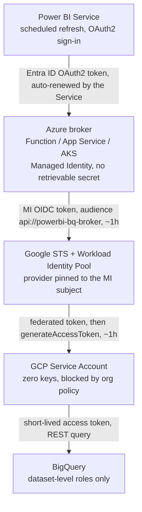

# Power BI to BigQuery: WIF Broker

**Scheduled refresh from Power BI to Google BigQuery with no long-lived GCP credential anywhere in the chain.**

This repo documents and demonstrates an **Azure-hosted identity and query broker** pattern. The scenario is fictional (Contoso), but the problem is common: the native Power BI BigQuery connector authenticates with a GCP service-account JSON key that lives for about a year in plain text, and many security teams no longer accept standing secrets of any kind.

The broker moves the Workload Identity Federation (WIF) responsibility out of the Power BI connector, which cannot do it, and into an Azure workload that natively has a Managed Identity. Every credential in the chain is minted per request and expires within about an hour.

> **Status:** reference sample and runbook, not production code and not official Microsoft or Google guidance. Review with your security team before use.

## The problem

Contoso's security standard requires least-privilege access and **no standing secrets**. The options usually on the table all fail that bar:

| Option | Why it fails |
| --- | --- |
| Native connector with a service-account JSON key | ~1-year key stored in plain text; a leaked file is a year of exposure |
| One all-access account with a longer-lived token | Maximum blast radius, violates least privilege |
| Third-party ODBC connector | Anyone who knows the DSN can use it; no per-user security |
| Workforce Identity Federation with exception groups | Tokens do not auto-renew for scheduled refresh at scale |
| Custom WIF connector inside Power BI | Works, but REST-only: ~10x slower, no DirectQuery, no paginated reports |

## Architecture



Power BI talks only to the broker, with Entra ID OAuth. The broker presents its Managed Identity token to Google STS, impersonates a keyless service account, and runs the query. Nothing persists between runs.

## Why no long-lived secret exists

| Link in the chain | Credential | Lifetime | Where it is stored |
| --- | --- | --- | --- |
| Power BI to broker | Entra ID OAuth2 access token | ~60 to 90 min | Nowhere; the Power BI Service renews it automatically |
| Broker identity | Azure Managed Identity | No retrievable secret exists | Platform-managed |
| Broker to Google STS | Entra OIDC token for the MI | ~1 hour | In memory only |
| Google STS exchange | Federated STS token | ~1 hour | In memory only |
| SA impersonation | Short-lived SA access token | Default 1 hour | In memory only |
| GCP service account | Zero keys ever created | n/a | Key creation blocked by `constraints/iam.disableServiceAccountKeyCreation` |

Two points worth making to a security review:

1. The service account is keyless **by construction**, not by convention: the org policy makes key creation impossible.
2. Renewal is server-side and per request, so scheduled refresh never depends on a human re-authenticating or on a stored credential.

## Repository layout

```
README.md                      This file
docs/RUNBOOK.md                Full step-by-step runbook (Azure, GCP, Power BI, validation, hardening)
broker/function_app.py         Sample Azure Function implementing the token exchange and query
broker/queries.json            Allowlisted named queries the broker will run
scripts/setup-azure.sh         az CLI commands for the Azure side
scripts/setup-gcp.sh           gcloud commands for the GCP side (pool, provider, SA, IAM)
test/test_wif_chain_local.py   Level 1 smoke test: validates the whole GCP trust chain from your laptop
test/README.md                 How to run the tests
```

## Quickstart

1. Run `scripts/setup-gcp.sh` (edit the variables at the top) to create the Workload Identity Pool, the OIDC provider trusting your Entra tenant, and the keyless service account.
2. Run `scripts/setup-azure.sh` to deploy the Function with a system-assigned Managed Identity and register the broker's Entra app.
3. Deploy `broker/` to the Function and connect Power BI with the Web connector using Organizational account (OAuth2).

The full detail, including validation checklists and hardening, is in [docs/RUNBOOK.md](docs/RUNBOOK.md).

## Testing: start simple

Three levels, cheapest first. Level 1 requires **no Azure deployment at all** and proves the entire GCP side in minutes.

| Level | What it proves | What it needs |
| --- | --- | --- |
| 1. Local smoke test | Pool, provider, SA binding and BigQuery IAM all work; tokens are short-lived | Your laptop, `az login`, Python. Queries a BigQuery **public dataset**, so no customer data is involved |
| 2. Deployed broker | The Managed Identity path works end to end | The Function deployed, one `curl` with an Entra token |
| 3. Power BI | Scheduled refresh runs unattended | Power BI Desktop + Service, OAuth2 credential on the dataset |

See [test/README.md](test/README.md) for the exact commands.

## Known limitations

- The broker sits on the BigQuery REST path: expect slower refresh than the native connector, no DirectQuery, no paginated Report Builder. It fixes credentials, not speed.
- Before investing heavily, re-check the first-party **Google BigQuery (Microsoft Entra ID)** connector: it is GA, uses Entra ID JWTs with Google Workforce Federation, and its newer implementation uses the BigQuery Storage API. If it meets your scheduled-refresh requirements, you may not need a broker at all.

## References

- [Google BigQuery (Microsoft Entra ID) connector](https://learn.microsoft.com/en-us/power-query/connectors/google-bigquery-aad), Microsoft Learn
- [Workload Identity Federation overview](https://cloud.google.com/iam/docs/workload-identity-federation), Google Cloud
- [Configure WIF with other clouds (Azure)](https://cloud.google.com/iam/docs/workload-identity-federation-with-other-clouds), Google Cloud
- [Google STS token exchange](https://cloud.google.com/iam/docs/reference/sts/rest/v1/TopLevel/token), Google Cloud
- [generateAccessToken](https://cloud.google.com/iam/docs/reference/credentials/rest/v1/projects.serviceAccounts/generateAccessToken), Google Cloud
- [Managed identities for Azure resources](https://learn.microsoft.com/en-us/entra/identity/managed-identities-azure-resources/overview), Microsoft Learn
- [Access BigQuery data in Power BI with Workforce Identity Federation](https://docs.cloud.google.com/iam/docs/workforce-sign-in-power-bi), Google Cloud

## License

MIT. See [LICENSE](LICENSE).
